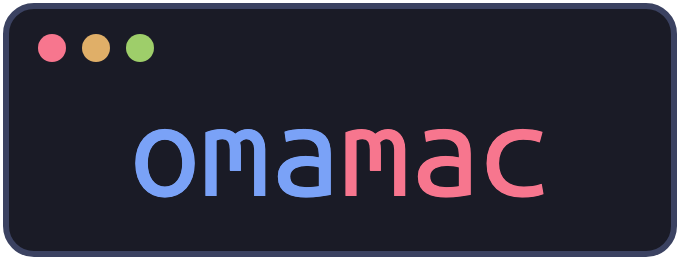
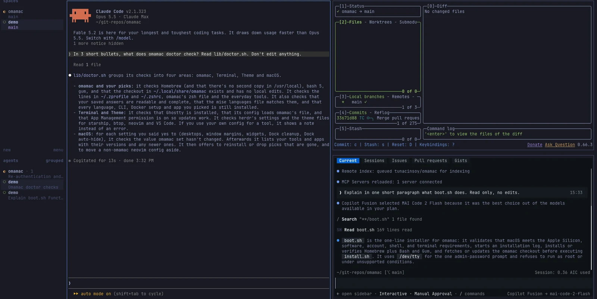
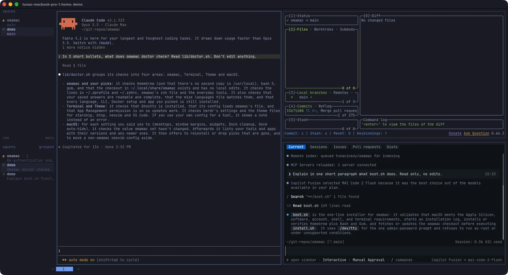
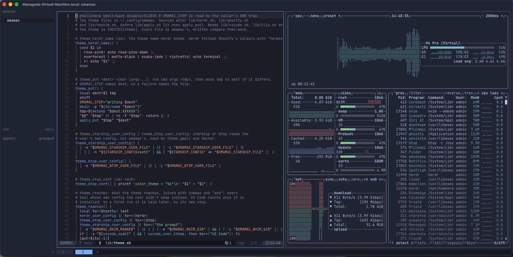
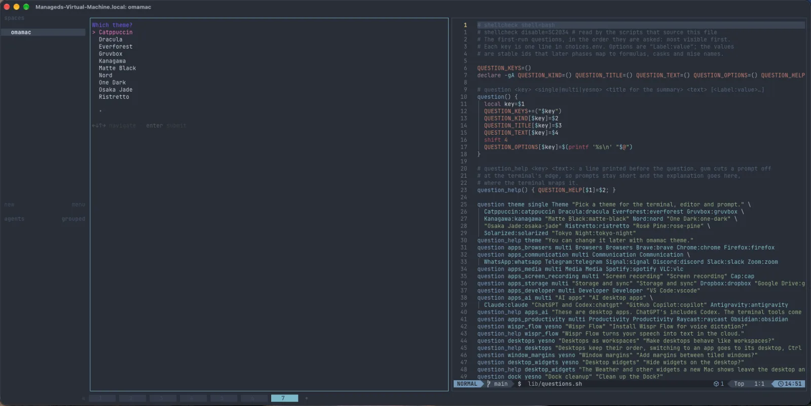
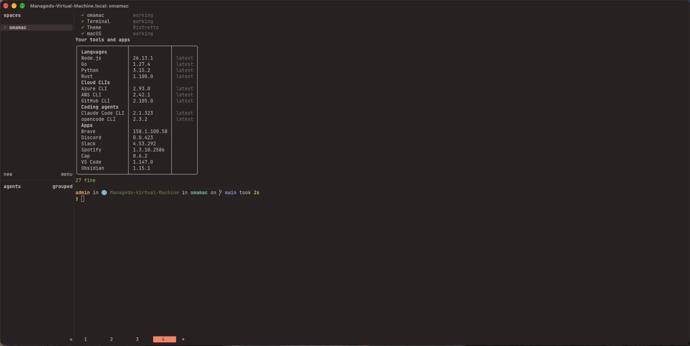
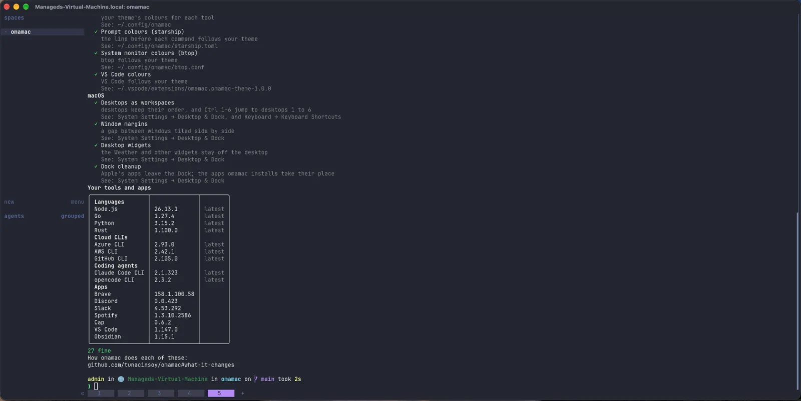
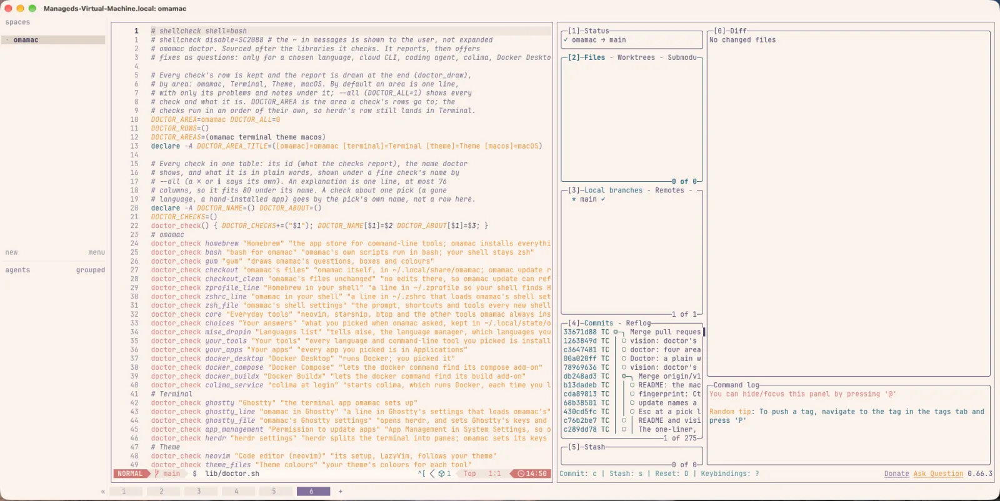

<p align="center">
  
</p>

<h1 align="center">Your Mac, fully loaded.</h1>

<p align="center">
  One command turns a fresh Mac into a dev machine you'll love.<br>
  <sub>The <a href="https://github.com/basecamp/omakub">Omakub</a> "one script, done" experience, for macOS. Sister of <a href="https://github.com/tunacinsoy/omawsl">omawsl</a>.</sub>
</p>

<p align="center">
  <a href="https://github.com/tunacinsoy/omamac/releases"></a>
  
  
  
</p>

<p align="center">
  
</p>

```bash
curl -fsSL https://raw.githubusercontent.com/tunacinsoy/omamac/main/boot.sh | bash
```

<sub>Paste it in Terminal. It asks a few questions, then runs on its own for 10 to 20 minutes (<a href="docs/install.md">what happens</a>).</sub>

## What you get

<table>
  <tr>
    <td width="42%"><b>A terminal that feels like home</b><br><sub>Ghostty opens straight into herdr's panes and tabs.</sub></td>
    <td><code>Ghostty</code> <code>herdr</code> <code>lazygit</code> <code>btop</code> <code>starship</code> <code>fzf</code></td>
  </tr>
  <tr>
    <td><b>AI agents, side by side</b><br><sub>In the terminal, or as apps.</sub></td>
    <td><code>Claude Code</code> <code>Codex</code> <code>Copilot CLI</code> <code>Antigravity</code> <code>opencode</code></td>
  </tr>
  <tr>
    <td><b>Your languages, nothing else</b><br><sub>Pick what you need. Nothing is pre-ticked.</sub></td>
    <td><code>Ruby on Rails</code> <code>Node.js</code> <code>Go</code> <code>Python</code> <code>Elixir</code> <code>Rust</code> <code>Java</code></td>
  </tr>
  <tr>
    <td><b>Editors, themed to match</b><br><sub>Switch the theme; VS Code changes while open.</sub></td>
    <td><code>Neovim</code> <code>VS Code</code></td>
  </tr>
  <tr>
    <td><b>Your apps, from one list</b><br><sub>Browsers, chat, music, notes, screen recording.</sub></td>
    <td><code>Brave</code> <code>Chrome</code> <code>Slack</code> <code>Discord</code> <code>Spotify</code> <code>Obsidian</code> <code>Raycast</code> <code>Cap</code> <code>…</code></td>
  </tr>
  <tr>
    <td><b>Desktops that stay put</b><br><sub>One purpose per desktop, Ctrl 1–6 to jump.</sub></td>
    <td><code>Ctrl 1–6</code> <code>no widgets</code> <code>a clean Dock</code></td>
  </tr>
  <tr>
    <td><b>Docker, your way</b><br><sub>Light or full.</sub></td>
    <td><code>colima</code> <code>Docker Desktop</code> <code>lazydocker</code></td>
  </tr>
  <tr>
    <td><b>Cloud CLIs on tap</b><br><sub>Sign in and go.</sub></td>
    <td><code>Azure CLI</code> <code>AWS CLI</code> <code>Google Cloud</code> <code>GitHub CLI</code> <code>Terraform</code></td>
  </tr>
  <tr>
    <td><b>Leaves your own setup alone</b><br><sub>One line added to your config files, never a rewrite; uninstall puts settings back. <a href="docs/what-it-changes.md">What it changes.</a></sub></td>
    <td>🛡️ <sub>safe to try</sub></td>
  </tr>
</table>

## See it

<table>
  <tr>
    <td width="50%"><br><b>Two agents and git, one screen</b> <sub>· Tokyo Night</sub></td>
    <td width="50%"><br><b>Code and system at a glance</b> <sub>· Catppuccin</sub></td>
  </tr>
  <tr>
    <td><br><b>Pick a theme, everything follows</b> <sub>· Nord</sub></td>
    <td><br><b>Is everything healthy? One command</b> <sub>· Ristretto</sub></td>
  </tr>
  <tr>
    <td><br><b>Every check, in plain words</b> <sub>· Dracula</sub></td>
    <td><br><b>Light, too</b> <sub>· Rosé Pine</sub></td>
  </tr>
</table>

<p align="center"><sub>
  All 13 themes: Catppuccin · Dracula · Everforest · Gruvbox · Kanagawa · Matte Black · Nord · One Dark · Osaka Jade · Ristretto · Rosé Pine · Solarized · Tokyo Night
</sub></p>

## Your daily commands

Type `omamac` and it asks what you want. Each command below asks what it needs, too.

<table>
  <tr><td width="42%"><code>omamac theme</code></td><td>Switch the look everywhere (<a href="docs/themes.md">how</a>)</td></tr>
  <tr><td><code>omamac update</code></td><td>Update omamac, your tools and apps (<a href="docs/updating.md">how</a>)</td></tr>
  <tr><td><code>omamac install</code></td><td>Add an app, language or tool you skipped</td></tr>
  <tr><td><code>omamac uninstall</code></td><td>Remove one, cleanly (<a href="docs/uninstalling.md">how</a>)</td></tr>
  <tr><td><code>omamac configure</code></td><td>Turn a macOS setting on or off, such as Dock auto-hide</td></tr>
  <tr><td><code>omamac doctor</code></td><td>Check that everything's healthy (<code>--all</code> for every check)</td></tr>
</table>

<sub>Not sure which one? <a href="docs/commands.md">Commands</a> lists what each takes.</sub>

## Good to know

<details open>
<summary><b>Before you begin</b></summary>
<br>

- A Mac with Apple Silicon, on macOS 27 or later, with an administrator account.
- Setup Assistant finished, macOS up to date, and an internet connection.
- Back it up if it has anything you care about.

</details>

<details>
<summary><b>After install</b>: a few clicks left</summary>
<br>

A short checklist: open Ghostty, allow a few permissions, make six desktops, set up git and SSH. See [After install](docs/after-install.md).

</details>

<details>
<summary><b>What omamac deliberately leaves out</b></summary>
<br>

- **A tiling window manager:** macOS desktops, with omamac's settings, are enough.
- **The Mac App Store:** apps come only from Homebrew.
- **Your git identity, SSH keys and GitHub sign-in:** they stay yours.
- **Sign-ins, keys and licences** for apps and agents: omamac stores none.
- **A second multiplexer:** herdr only, no zellij.
- **Xcode, OrbStack and PHP:** not offered.

</details>

## Docs

[Install](docs/install.md) · [After install](docs/after-install.md) · [Commands](docs/commands.md) · [Updating](docs/updating.md) · [Themes](docs/themes.md) · [herdr](docs/herdr.md) · [Uninstalling](docs/uninstalling.md) · [What it changes](docs/what-it-changes.md) · [Testing changes](docs/testing-changes.md) · [Contributing](CONTRIBUTING.md)

<p align="center"><sub>Inspired by <a href="https://github.com/basecamp/omakub">Omakub</a> · made for macOS on Apple Silicon</sub></p>
